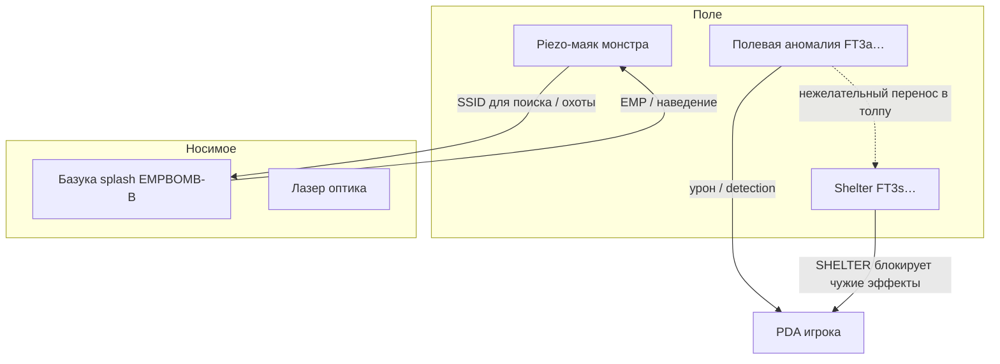

# Аномалии старой системы (FT3)

Описание семейства «аномальных» и связанных hazard-устройств старой системы: полевые аномалии, убежище, направленное оружие/вспышки, цели монстров, плюс обнаружение опасностей на PDA по восприятию.

Источники прошивок полевой аномалии:

- **`scanomaly_miniS1_a2-2.ino`** — более полная логика приёма (`K` + таймер выключения);
- **`scanomaly_wemos_a3_ledshield.ino`** — тот же протокол, другой LED (NeoPixel), **без** обработчика `K`.

Также: `anomalies_FT3.txt`, ODT `Metalife_Fallout_description_vB6_uF2.odt`, PDA `pda_8266_b8-1.ino`, `preparates.md`, `bazooka_a2.ino`, `lazergun_a1.ino`, `piezo_*_target_*.ino`.

Где поведение полевых плат расходится — «miniS1» / «wemos a3».

## 1. Типы устройств

В старой системе под «аномалиями» и смежными hazard-устройствами живут несколько ролей. Общий канал чаще всего — **Wi‑Fi SSID на канале 4**; урон игроку почти всегда считает PDA.

| # | Тип | Назначение | Примеры |
|---|-----|------------|---------|
| 1 | **Полевая аномалия** | Стационарная зона на площадке: постоянно вещает эффектный `FT3…` | `radcockroach`, `gas`, `Freezer`, … (`scanomaly_*`) |
| 2 | **Shelter (убежище)** | Специальная полевая аномалия: **отключает действие других аномалий** на PDA игрока в зоне / на время после ухода | `FT3s36803` / shelter |
| 3 | **Направленного действия** | Носимое/событийное воздействие: короткий splash или оптический «луч», не стационарная зона | базука `bazooka_a2.ino`; лазер `lazergun_a1.ino` (+ связанные SSID взрывов в каталоге) |
| 4 | **Цель / маяк монстра** | Доп. контур поиска и поражения «монстров»: piezo-хиты + Wi‑Fi маяк (и опционально взрывной SSID) | `piezo_monster_target_wemos_type2.ino`, `piezo_universal_target_wemos_type3.ino` |



### 1.1. Полевая аномалия (основной тип)

Устройство на ESP8266 (`scanomaly_*`):

1. Вещает SoftAP с SSID протокола Metalife (`FT3…`).
2. Сканирует канал на чужие `FT3*` и реагирует на `B` / `K` / `F` / `C`.
3. Даёт свет/звук.

Урон считает **PDA** (`ProcessUCP31` → `MLCount`). Пример из каталога: `FT3a25805_a27756` — radcockroach.

Двусторонний канал: излучение эффекта + приём болта / ключа инженера / поиска / мимикрии.

Подробности железа, протокола и CLI — §2–§6.

### 1.2. Shelter — защита от чужих аномалий

**Игровой смысл:** если кто-то принёс переносную аномалию в скопление игроков, shelter гасит вред от чужих зон — «противоядие» от неразумного заноса hazard’а в безопасное место.

**В коде:** SSID `FT3s36803` → команда `s` на переменную `SHELTER` (36): при достаточном RSSI `MLP[SHELTER] = 3` (и т.п. по конфигу).

Пока `SHELTER > 0` на PDA каждый тик:

- обнуляются `RADNOW` / `CHEMBIO` / `PHYSICAL` / `MODTEMP`;
- сбрасываются флаги восприятия опасностей;
- счётчик `SHELTER` уменьшается на 1 (иммунитет ещё N секунд **после ухода** из зоны убежища).

Также при `SHELTER > 0` не выставляются perception-флаги и не показываются иконки rad/chem/phy от аномалий (§7).

### 1.3. Аномалии / устройства направленного действия

Не зона на полу, а **точечный/направленный** акт.

**Базука** (`bazooka_a2.ino`, протокол меток `BZ1`):

- Сканирует цели: `PA-CONFIG-DEFAULT`, `PA-DEFAULT`, **`FT3a27780`** (в каталоге — Monster ssid, PHYSICAL +80).
- Показывает шкалу близости к цели (RSSI → полоска на OLED).
- Выстрел (длинный клик ×3 при наличии зарядов): splash **`EMPBOMB-B`** мощностью 23 ≈ 0,5 с.
- Заряды через NFC-метки `PROTO:BZ1`.

**Лазер** (`lazergun_a1.ino`):

- В этой прошивке **нет Wi‑Fi**: кнопка → DFPlayer + поочерёдное включение лазерных диодов (оптический «луч»).
- Связь с Metalife-каналом — на уровне площадки/каталога: например записи взрывов `FT3i279002300_…` (Ramil lazergun explosion), а не код самого лазера.

Итог: направленный контур = короткий эфирный splash и/или физический луч, в отличие от постоянно вещающей полевой аномалии.

### 1.4. Цели монстров (поиск и поражение)

Дополнительный контур к полевым аномалиям: **найти** существо по Wi‑Fi-маяку и **поразить** piezo / EMP.

| Прошивка | Роль |
|----------|------|
| `piezo_monster_target_wemos_type2.ino` | Маяк `MON-DEFAULT` (настраиваемый SSID/power), piezo-хиты, regen/resurrect; только AP, без скана EMP |
| `piezo_universal_target_wemos_type3.ino` | Маяк `TARGET-DEFAULT` + скан: `EMPBOMB-B` убивает и может выдать `expssid` (взрыв), `REPDEV-A` чинит, `RESDEV-C` воскрешает |

Связка с базукой: базука ищет в том числе `FT3a27780` / PA-SSID и стреляет `EMPBOMB-B` → universal target гибнет и кратковременно вещает `expssid` (в каталоге — инкрементальные «взрывы» вроде Power armor explosion).

Мастерский поиск полевых аномалий (`FT3F` / FindMe) — отдельный механизм на `scanomaly_*`, не piezo.

## 2. Железо полевой аномалии и режим работы

Общее для обеих прошивок:

| Параметр | Значение по умолчанию |
|----------|------------------------|
| Платформа | ESP8266, `WIFI_AP_STA`, PHY 11B |
| Канал | `4` |
| SoftAP SSID | `ANOMALY` → игровой SSID эффекта |
| Пароль AP | `defaultpass` |
| Мощность | `10` (0–20 дБм) |
| Клиентов AP | максимум 1 |
| CLI по Wi‑Fi | TCP `:1337` |
| Конфиг EEPROM | ssid, pass, power, chan, nut |

| | `scanomaly_miniS1_a2-2` | `scanomaly_wemos_a3_ledshield` |
|--|-------------------------|--------------------------------|
| LED | RGB `analogWrite` пины 12/13/14, `LED_INVERSE` | NeoPixel 1× на D2 (пин 4) |
| Buzzer | пин 4, активный уровень **LOW** | пин 5, активный уровень **HIGH** |
| Blink pause | `blinklow` 300 мс | 3000 мс |
| `sleep` CLI | есть (deep sleep + часовой счётчик) | закомментирован |
| Команда `K` | **есть** | **нет** |

При старте: пустой EEPROM → дефолты; иначе чтение конфига → AP+скан → CLI. У miniS1 при буте короткая зелёная вспышка.

## 3. Протокол SSID (UCP)

```text
pIDcVVdd(ee)MM_
```

| Поле | Смысл |
|------|--------|
| `pID` | 3 символа (`FT3`; в ODT также `uS1` / `uF2`) |
| `c` | Символ команды |
| `VV` | Номер переменной Metalife |
| `dd` | Порог RSSI без минуса (`80` → −80 дБм) |
| `ee` | Шаг дБм (только `i`) |
| `MM` | Модификатор (длина переменная) |
| `_` | Разделитель команд |

SSID ≤ 32 символа.

### 3.1. Команды для PDA

`ProcessUCP31()` в `pda_8266_b8-1.ino`:

| `c` | При `RSSI ≥ порога` |
|-----|---------------------|
| `s` | `MLP[VV] = MM` |
| `a` | `MLP[VV] += MM` |
| `i` | `MLP[VV] += MM * \|порог\| − \|RSSI\| / ee` |
| `e` | Остаток SSID → `AddEffect(...)` |

Если `RSSI + PERCEPTION + MODPERCEPTION ≥ порога` и `SHELTER ≤ 0` — флаги раннего обнаружения (`RadPflag` / `ChemPflag` / `PhyPflag`); подробно — §5.

Один BSSID — один раз за тик Metalife (`ScanStack`, очистка каждую секунду).

### 3.2. Входные команды на аномалию

| `c` | Назначение | miniS1 | wemos a3 |
|-----|------------|--------|----------|
| `B` | **Болт** — идентификация типа по `nut` | свет+звук по `nut` | то же |
| `K` | **Ключ инженера** — выключить на N минут | да, **только** если `nut` ∈ {`C`,`G`} | нет |
| `F` | Поиск мастерами | `FindMe()` ~20 с | то же |
| `C` | **Мимикрия** — подхватить и продолжить чужой сигнал (напр. всеобщее уничтожение) на время | клон SSID отправителя на `TTTT` мин + кулдаун 60 мин | то же |
| `R` | Ремонт силовой брони (ODT) | нет (NFC на PDA) | нет |

### 3.3. Переменные Metalife для аномалий

| № | Имя | Роль |
|---|-----|------|
| 25 | `RADNOW` | Острая радиация тика |
| 26 | `CHEMBIO` | Хим/био урон тика |
| 27 | `PHYSICAL` | Физ. урон тика |
| 34 | `MODTEMP` | Модификатор температуры |
| 36 | `SHELTER` | Убежище: иммунитет на N тиков после ухода |

После тика `RADNOW` / `CHEMBIO` / `PHYSICAL` / `MODTEMP` обнуляются — нужна повторная «подпитка» сканом.

## 4. Жизненный цикл воздействия на игрока

1. Полевая аномалия вещает, например `FT3a25805_a27756`.
2. PDA находит SSID → `ProcessUCP31`.
3. При достаточном RSSI копятся параметры тика **или** (раньше по дистанции) флаги восприятия — §5.
4. Раз в ~1 с `MLCount()`: сопротивления, броня, урон, индикация.
5. Вне зоны — в следующем тике добавок нет.

**Shelter** (§1.2): пока `SHELTER > 0`, воздействия и иконки опасностей от аномалий подавлены; после ухода из зоны счётчик ещё тикает вниз.

## 5. Обнаружение опасностей и восприятие

На PDA опасность от полевой аномалии делится на два порога по одной и той же команде SSID (`a`/`s`/`i` с порогом RSSI `trrssi`):

| Условие | Результат |
|---------|-----------|
| `RSSI ≥ trrssi` | **Воздействие**: изменение `MLP` (урон / set / inc) |
| `RSSI + PERCEPTION + MODPERCEPTION ≥ trrssi` и `SHELTER ≤ 0` | **Обнаружение**: флаг типа без обязательного урона |

`PERCEPTION` / `MODPERCEPTION` — характеристики SPECIAL (индексы 2 и 9). Чем выше сумма, тем **раньше** (при более слабом сигнале, дальше от источника) игрок видит опасность.

### 5.1. Пример

Порог в SSID `80` → `trrssi = −80`.

| RSSI | P+ModP | Урон? | Обнаружение? |
|------|--------|-------|--------------|
| −75 | 0 | да (−75 ≥ −80) | да |
| −85 | 0 | нет | нет (−85 ≱ −80) |
| −85 | 5 | нет (−85 ≱ −80) | да (−85+5 ≥ −80) |
| −90 | 5 | нет | нет (−85 ≱ −80) |
| −90 | 10 | нет | да |

Игрок с высоким восприятием получает **предупреждение** (иконка), ещё не входя в зону полного урона.

Флаг ставится по целевой переменной команды:

| `mlvar` | Флаг | Тип опасности |
|---------|------|---------------|
| 25 `RADNOW` | `RadPflag` | радиация |
| 26 `CHEMBIO` | `ChemPflag` | хим/био |
| 27 `PHYSICAL` | `PhyPflag` | физика |

При обнаружении экран PDA включается (`ScreenOnTimeActive`).

Флаги и тиковые `RADNOW`/`CHEMBIO`/`PHYSICAL` сбрасываются каждый Metalife-тик (~1 с), пока сеть снова не попадёт в скан.

### 5.2. Отображение на главном экране (`IndicationMode == 'A'`)

Пока жив и экран активен, при `SHELTER ≤ 0`:

| Сигнал | Иконка | Звук |
|--------|--------|------|
| `RADNOW > 0` или `RadPflag` | мигающий знак радиации (верх справа) | короткий тик buzzer **только если** после резистов `RADNOW − RADRESIST > 0` (при одном `RadPflag` без урона — **тихо**) |
| `CHEMBIO` или `ChemPflag` | biosign (низ справа, в фазе blink) | buzzer если урон после резистов |
| `PHYSICAL` или `PhyPflag` | physign (тот же слот, **противофаза** blink к био) | то же для физ. урона |

Термо-опасность идёт отдельно через `ThermalState` / `PLAYERTEMP` (снежинка, пламя, ±C), не через perception-флаги `a25/a26/a27`.

Голод/жажда — свои иконки слева, не связаны с аномалиями.

### 5.3. Режим сканера `SCAN`

NFC-тег с ключом `SCAN` переводит PDA в `IndicationMode == 'S'`: на экране число видимых `FT3` сетей, лучший RSSI и хвост SSID. Пока режим активен, каждый кадр ставит `SHELTER = 3` — краткий иммунитет во время мастерского сканирования.

### 5.4. Итог по восприятию

- Восприятие **не усиливает урон** и не сдвигает порог `a`/`s`/`i`.
- Восприятие **расширяет кольцо предупреждения** на величину `P + ModP` дБм.
- Shelter и режим `SCAN` глушат и урон, и предупреждения от аномалий.

## 6. Входные сигналы полевой аномалии

### 6.1. Болт (`B`)

Вход с устройства игрока. Аномалия реагирует **идентификацией типа** по `nut`:

| `nut` | Реакция на `B` |
|-------|----------------|
| `E` | Синий + `ElectroSound` |
| `C` | Зелёный + `ChembioSound` |
| `G` | Красно-синий + `GraviSound` |
| `T` | Красный + `ThermoSound` |
| `N` | Нет реакции |

Выключения SoftAP по `B` **нет ни в одной** из двух прошивок — только свет/звук. Если по задумке болт ещё и гасит зону, это отдельная недописанная ветка (либо гашение завязано только на `K`).

Код отправки `FT3…B…` с PDA в репозитории не найден.

В обеих прошивках у `case 'T':` после `ThermoSound()` **нет `break`**.

### 6.2. Ключ инженера (`K`) — выключение (miniS1)

Реализация в `scanomaly_miniS1_a2-2.ino`:

```text
условие: comc == 'K' && (nut == 'C' || nut == 'G')
KeyTimeoutMin = число после K  (минуты)
RestartAPScan("NOTHING", 0)   // эффектный SSID гасится
по таймеру → RestartAPScan(ssid, power)  // возврат
```

Смысл:

- PDA инженера шлёт `FT3K{N}` (`N = (INTELLECT − 6) × 3`, см. `preparates.md` §6.5).
- Аномалия с типом **химбио (`C`) или грави (`G`)** перестаёт излучать игровой SSID: вещает `NOTHING` на мощности 0.
- Через `N` минут (дефолт таймера в коде — 3, но сразу перезаписывается из SSID) возвращает свой `ssid`/`power`.
- Типы **`E` (электро) и `T` (термо)** на `K` **не реагируют** — ограничение в коде, не баг парсера.

В `scanomaly_wemos_a3_ledshield.ino` этой ветки нет — инженерский splash до аномалии не доходит.

### 6.3. Мимикрия `C`

**Игровой смысл:** при запуске **всеобщего уничтожения** или излучения того же формата аномалия, увидев сигнал, **не просто получает команду** — она **перехватывает и продолжает имитировать** этот SSID заданное время. Пока идёт мимикрия, игроки в зоне слышат/ловят уже не «родную» аномалию (radcockroach и т.п.), а клонированный сигнал уничтожения (или иной splash). По таймеру устройство **возвращается к своим стандартным** `ssid` / `power` из конфига.

Типичный сценарий:

1. Источник (PDA/устройство события) кратко вещает SSID с командой клона, например `FT3C{pp}{TTTT}_…` плюс полезный хвост эффекта (в каталоге рядом по смыслу — Destruct `FT3eTAR15 SET0 …` и подобные).
2. Полевая аномалия в радиусе скана видит `C`, переключает SoftAP на **SSID отправителя** и мощность `pp`.
3. Дальше сама **держит** этот эфир `TTTT` минут (`ChainTimeoutMin`) — продлевает вспышку уничтожения по площадке.
4. По окончании — `RestartAPScan(ssid, power)`: снова своя штатная аномалия.
5. Кулдаун **60 мин** (`CooldownTimeoutMin`): повторный `C` игнорируется, пока кулдаун не спадёт.

Синтаксис в прошивке: `CppTTTT` — `pp` мощность (2 цифры), `TTTT` длительность мимикрии в минутах.

Условие старта: нет активного клона и нет кулдауна (`!ChainTimeActive && !CooldownTimeActive`).

Эмиттер `FT3C…` в репозитории отдельно не найден — его шлёт контур события «уничтожение» / аналог.
### 6.4. Поиск `F`

`FindMe()`: ~20 с белый миг + писк. Каталог: `FT3F` / finder.

## 7. Индикация и CLI полевой аномалии

Команды света: `RED_light`, `GREEN_light`, `BLUE_light`, `NO_light`, `BLINK_ON`, `BLINK_OFF`.

CLI (Serial / `:1337`): `ssid`, `pass`, `power`, `chan`, `nut`, `save`, `show`, `defaults`, `flush`, `APPLY`, `reboot`, `info`, `confreq`, `test 1..5`.

У miniS1 дополнительно: `sleep <минуты>` (deep sleep; при ≥60 — счётчик часов в EEPROM).

`confreq` отдаёт параметры приложению настройки (`-|string|…`, `-|byte|…`, `-|cmd|…`). После смены SSID/канала — `APPLY`.

## 8. Каталог SSID (`anomalies_FT3.txt`)

Колонка **шт.** — число экземпляров на площадке.

| SSID | Имя | Эффект (при достаточном RSSI) | шт. | pow |
|------|-----|-------------------------------|-----|-----|
| `FT3a25805_a27756` | radcockroach | RADNOW +5 (−80), PHYSICAL +6 (−75) | 7 | 17 |
| `FT3a26805_a27756` | molerat | CHEMBIO +5 (−80), PHYSICAL +6 (−75) | 8 | 19 |
| `FT3a258014` | big_rad | RADNOW +14 (−80) | 6 | 19 |
| `FT3a25808` | small_rad | RADNOW +8 (−80) | 6 | 17 |
| `FT3a25809_a27759` | scorpion | RADNOW +9 (−80), PHYSICAL +9 (−75) | 2 | 20 |
| `FT3a26808` | gas | CHEMBIO +8 (−80) | 4 | 19 |
| `FT3s36803` | shelter | SHELTER := 3 (−80); блокирует др. аномалии (§1.2) | 4 | 20 |
| `FT3F` | finder | поиск | 2 | 20 |
| `FT3a3485-15_a27851` | Freezer | MODTEMP −15 (−85), PHYSICAL +1 (−85) | — | — |
| `FT3a25701` | Canister | RADNOW +1 (−70) | — | — |
| `FT3eTAR15 SET0 CONv29!=90` | Destruct | LIFE := 0 при условии; формат «уничтожения», может продлеваться мимикрией `C` (§6.3) | — | 20 |
| `FT3i279002300_i258502300` | Ramil lazergun explosion | инкрементальный физ + рад | — | 20 |
| `FT3i278003200_i258503200` | Power armor explosion | инкрементальный | — | 10 |
| `FT3a27780` | Monster ssid | PHYSICAL +80 (−70) | — | — |

Пример `FT3a25805_a27756`: `RADNOW += 5` при ≥ −80; `PHYSICAL += 6` при ≥ −75.

## 9. Связь с другими частями системы

| Компонент | Связь |
|-----------|--------|
| PDA | Скан `FT3`, урон, perception-флаги, shelter; splash инженера `FT3K{N}` |
| Устройство игрока (болт) | `B` → идентификация по `nut` |
| Базука | Наведение на PA / `FT3a27780`; выстрел `EMPBOMB-B` |
| Лазер | Оптический луч (без Wi‑Fi в `.ino`); связанные взрывы — в каталоге SSID |
| Piezo monster / universal | Маяки поиска и цели EMP / ремонта |
| `preparates.md` §6.5 | Инженер → `FT3K{N}` |
| ODT uF2 | Протокол аномалий (F/K/R) |

## 10. Что ещё не закрыто / расхождения сборок

1. **Болт `B` не гасит** излучение — только тип; если нужна пауза зоны по болту, логики нет.
2. **`K` только в miniS1** и только для `nut` = `C` или `G` (не для `E`/`T`/`N`).
3. **wemos a3** без `K` — инженер на этой плате бесполезен против аномалии.
4. Нет `break` в `case 'T'` болта (обе сборки).
5. Эмиттеры `B` / `C` в `docs/old_system` не найдены.
6. Префиксы в старых доках (`uF1`/`uF2`/`uS1`) vs боевой `FT3` — синтаксис общий.
7. Лазер не шлёт Metalife-SSID сам — связка с каталогом взрывов площадочная.

Ориентир для восстановления полевой аномалии: **miniS1** как эталон приёма `K` и гашения через `RestartAPScan("NOTHING", 0)`.

## 11. Источники

- `docs/old_system/scanomaly_miniS1_a2-2.ino` (эталон `K` / KeyTime)
- `docs/old_system/scanomaly_wemos_a3_ledshield.ino` (NeoPixel-сборка без `K`)
- `docs/old_system/anomalies_FT3.txt`
- `docs/old_system/pda_8266_b8-1.ino` (`ProcessUCP31`, perception-флаги, `Indicate`, shelter)
- `docs/old_system/bazooka_a2.ino`
- `docs/old_system/lazergun_a1.ino`
- `docs/old_system/piezo_monster_target_wemos_type2.ino`
- `docs/old_system/piezo_universal_target_wemos_type3.ino`
- `docs/old_system/Metalife_Fallout_description_vB6_uF2.odt`
- `docs/old_system/preparates.md` (§6.5)
- `docs/old_system/ml-ev5.h`
